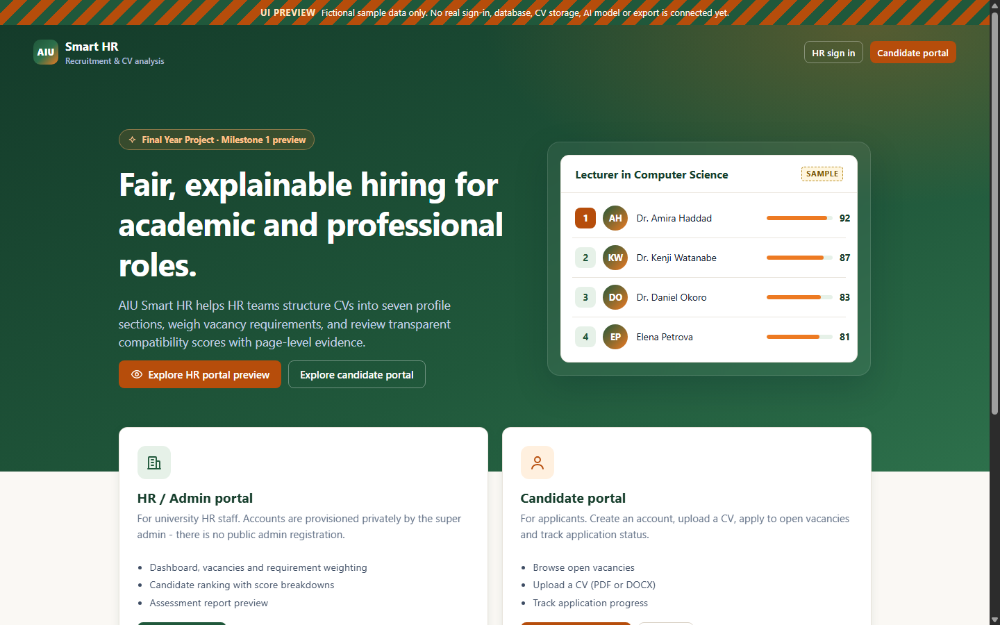

# HR & NLP CV Summarizer — Academic Case Study

An Albukhary International University (AIU) Computer Science final-year project exploring a structured HR portal for summarising and ranking a small, bounded set of CVs.

> **Project status: academic FYP with an approved ERD and a separate local UI-only Milestone 1 preview — not deployed.** The preview uses fictional data and simple weighted arithmetic, not a working NLP model, authentication or database integration. This public repository contains documentation only: no source code, real CVs, applicant records, credentials or private university materials.

## Academic UI milestone — fictional preview and independently rerun QA

The **local-only UI preview** has been independently tested in the **private** implementation repository: 12/12 Node tests, 42 SQLite schema assertions, 44 desktop/mobile route checks and 11 browser interactions. A read-only GitHub Actions workflow passed on Node 22 and Node 24 after the private main merge. **These are tests of a fictional-data academic prototype, not of a deployed NLP model or production HR service.** [Public synthetic screenshots, exact verification scope and caveats](docs/MILESTONE1-SYNTHETIC-QA-EVIDENCE.md) · [Mobile screenshot](assets/preview/academic-cv-mobile.png). The private CI and code are not inspectable to a signed-out recruiter.

## Project context

The project is supervised by Dr. Bashir. Its design explores how an HR reviewer could assess fewer than 10 CVs at a time against the same seven dimensions, using a consistent summary and ranking structure.

**My role:** Computer Science student, FYP contributor and designer.

## Seven evaluation dimensions

1. Qualifications
2. Experience
3. Location & Relocation
4. Soft and Hard Skills
5. References
6. Personal Information
7. Rewards

## Design decisions

- **Bounded review set:** intended for fewer than 10 CVs at a time.
- **Consistent criteria:** each CV is considered against the same seven dimensions.
- **Human review:** the system is intended to support a reviewer; the final decision remains with the human reviewer.
- **Data model first:** the ERD was approved for university submission.
- **Hosting considered, not deployed:** Cloudflare Pages and Workers were considered as possible hosting options.

## Intended workflow

The concept is organised around a short HR review path:

1. HR reviewer opens the portal.
2. A small CV set is considered.
3. Each CV is summarised against the seven dimensions.
4. Candidates are ranked for reviewer comparison.
5. The HR reviewer makes the final decision.

This describes the intended design, not a verified running workflow.

## Evidence and limitations

- The approved ERD is recorded as an academic milestone.
- No deployment is claimed.
- No model accuracy, dataset size, hiring outcome, time-saving figure or production integration is claimed.
- No applicant or CV data is published.
- The project is not presented as a completed HR product.

See [Project Scope](docs/PROJECT-SCOPE.md), [Concept Architecture](docs/ARCHITECTURE.md) and [Status & Evidence](docs/STATUS.md).

**Engineering milestone clarification:** The private project record also describes a local, non-deployed Milestone 1 **UI preview plus SQLite schema checks** using only fictional data. It does not implement an AI model, production authentication, database integration or CV processing. See [Engineering Evidence & Responsible Evaluation Plan](docs/ENGINEERING-AND-EVALUATION-PLAN.md) for the exact distinction and proposed next acceptance gates.

## Portfolio record

[Open the full portfolio case study](https://ahmed-gamil-portfolio.ahmedabdulbarim.workers.dev/case-studies/hr-nlp-cv-summarizer)

© 2026 Ahmed Gamil. Academic project documentation.
