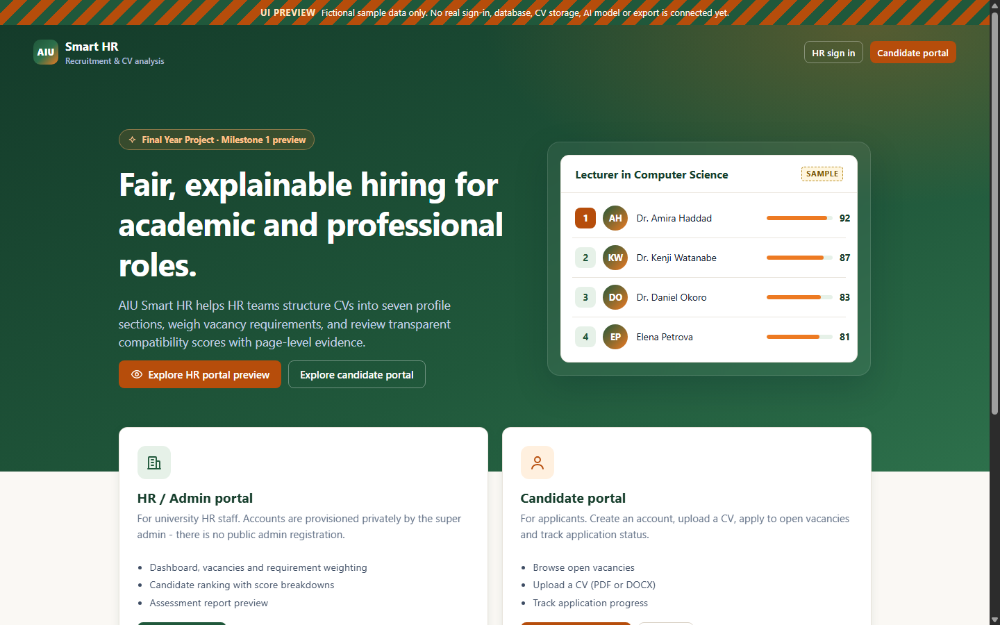
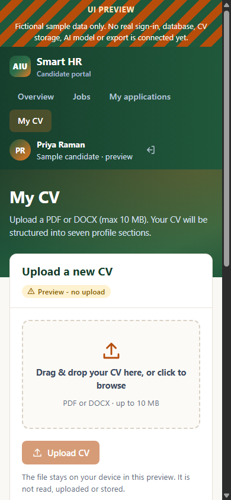

# Milestone 1 — Verified Private QA, Public Synthetic Preview

**AIU Smart HR academic final-year project · Engineering evidence update · 21 November 2026**

> **These are synthetic UI screenshots**, not records of actual applicants, employers, university personnel or real hiring results. The source code, automated CI logs, ERD implementation and quality test scripts remain in a **private** repository and are **not independently available to a public recruiter**. The descriptions below distinguish internal validation from public proof. This is not a deployed HR product or NLP system.

## What a recruiter can actually see

*Desktop snapshot: a fictional university-HR landing screen and static sample ranking. Names and score numbers are generated for interface demonstration only.*

*Mobile snapshot: a mock candidate CV screen. File selection is a local UI exercise. No real file is uploaded, parsed, stored or transmitted.*

### Project scope

The project explores a two-portal system for an HR reviewer and an applicant: requirement weights, CV-oriented profile sections, preview rankings and assessment reports. Its nine-table SQL schema is a **design artifact**, exercised in disposable in-memory SQLite tests; the interface has no database connection. Scores are **hand-authored fictional examples combined using deterministic weighted arithmetic**, not extracted by an AI model. There is no real login, CV processing, resume parsing, external service, PDF export or Cloudflare deployment.

## QA summary — private-source verification

On 21 November 2026, a separate isolated private clone was examined with Node.js 24.21.0 and Chrome 157.0.8103.79. Engineering corrections addressed input/weight normalization, non-finite scores, candidate/application association, simulated actions not actually disabled, a narrow-mobile overflow and keyboard navigation semantics.

| Check | Result | Precise scope |
|---|---|---|
| Application check | **Passed** | JS syntax, route rendering, no-browser-network/no-storage checks and synthetic-only emails |
| SQLite schema validation | **42 assertions passed** | Exactly nine tables, 14 foreign keys, constraints and audit-log append-only guards in *disposable in-memory* SQLite |
| Node built-in tests | **12/12 passed** | Deterministic arithmetic, invalid weights, score boundaries, XSS-safe rendering, applicant/view associations, schema rejection paths |
| Browser route/viewport checks | **44/44 passed** | 22 hash URLs at desktop 1440×900 and narrow mobile 390×844, not full device/browser coverage |
| Browser user interactions | **11/11 passed** | Skip link, menu focus, input weight controls, mock file selection and form placeholders |
| GitHub Actions | **Passed on Node 22 and Node 24 on source SHA and merged private main SHA** | Read-only workflow, no deploy; results require repository authorization to view |

**Private implementation record:** [AIU Smart HR source (access restricted)](https://github.com/a7medgamil/aiu-smart-hr), [merged engineering PR #1 (access restricted)](https://github.com/a7medgamil/aiu-smart-hr/pull/1), [post-merge CI (access restricted)](https://github.com/a7medgamil/aiu-smart-hr/actions/runs/44899037914). These links cannot be treated as public inspectable code or independent third-party certification. The values above are accurately described results of local and private CI review, not operational performance.

## Responsible engineering observations

**Deterministic ranking:** identical fictional inputs and weights should produce identical ordering. Weights should be nonnegative, finite, normalized without negative residuals and preserve intentionally zero-valued dimensions.

**Evidence must be traceable:** any future CV-derived claim should point to a source document and page/span; where extraction is uncertain the system should abstain and hand control to the reviewer instead of guessing.

**Separate authority and public view:** admin provisioning and candidate registration cannot share roles by default. The demo preview uses direct navigation by design, **not authentication or role enforcement**.

**Human hiring responsibility:** models and rules may help summarize; any real recruitment decision requires human oversight, consent/privacy controls and defensible job-related criteria. A fictional weight preview must not be described as a fairness-proven employment tool.

**Data limits:** existing student and employee identities, reference contact information and CV documents are never included in this public repository. The institution's academic requirements and permissions determine if any future dataset can be used.

## Reproduction and verification limits

A public reader can inspect the screenshots and this engineering method, but **cannot reproduce the private source tests from this showcase**. No fabricated public CI badge is offered for a documentation-only repo. Future public source examples should be separate original synthetic implementations with approved ownership.

This review does not establish accuracy, bias reduction, hiring fairness, model quality, real HR system security, accessibility conformance, privacy-law compliance, academic approval of later milestones, or deployment.

## Next evidence milestones (proposed, not done)

- [ ] A separate authorized and synthetic-only public baseline scoring demo with independently reproducible CI.
- [ ] A redacted requirements-to-test traceability matrix approved for academic use.
- [ ] A consent-cleared/synthetic annotation protocol for NLP extraction; per-field precision/recall and abstention must be measured, not invented.
- [ ] Human reviewer correction workflows and job-related feature-audit design.
- [ ] Security design for storage, privacy, retention, provenance, access and model-output prompt injection before real CV processing.
- [ ] Full keyboard, assistive-technology and hardware-device verification.

**Reviewer takeaway:** careful honesty about what a prototype proves is part of the engineering evidence. Current work demonstrates bounded requirements, data design, reproducible local QA and source-limited presentation; it does *not* claim a complete AI recruitment service.
